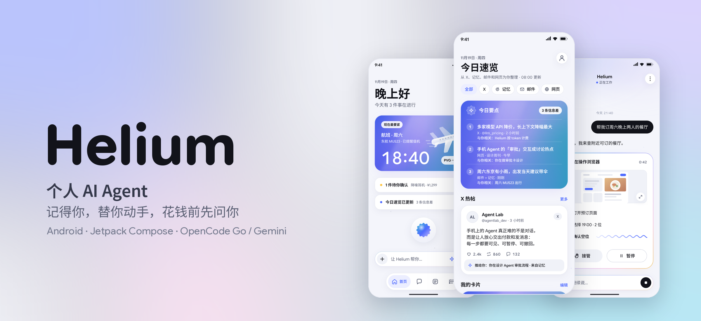
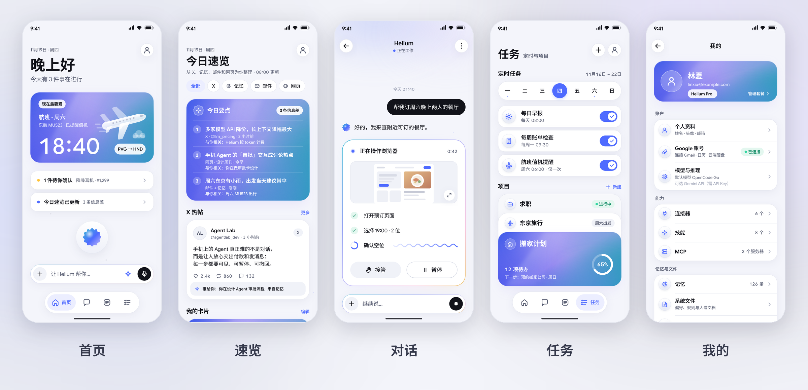
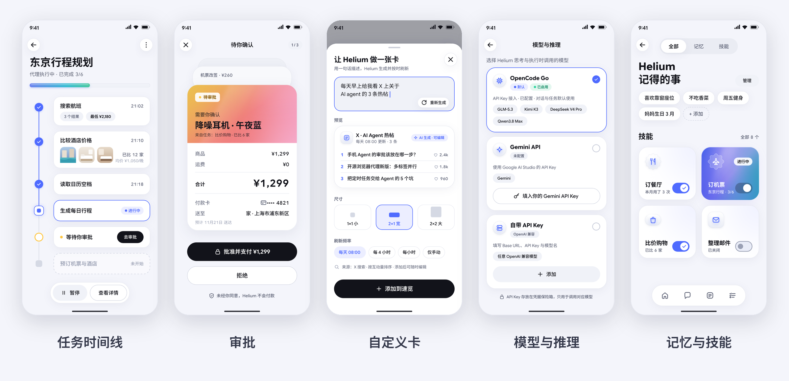

<div align="center">



<h3>记得你，替你动手，花钱前先问你。</h3>

<p>Helium 是装在手机里的个人 AI Agent —— 对话、每日速览、定时任务、记忆与技能，<br/>每一次付款或发送都先停在一张审批卡上，等你点头。</p>

<p>
  <a href="https://github.com/QiGai77/helium/releases/latest"></a>
  <a href="https://github.com/QiGai77/helium/actions/workflows/android.yml"></a>
  
  
  <a href="LICENSE"></a>
</p>

<p>
  <a href="https://github.com/QiGai77/helium/releases/latest/download/helium.apk"><b>⬇ 下载 APK</b></a>
  &nbsp;·&nbsp; <a href="#-快速开始">快速开始</a>
  &nbsp;·&nbsp; <a href="design/README.md">设计稿</a>
  &nbsp;·&nbsp; <a href="docs/PLAN.md">产品方案</a>
</p>

</div>

<br/>



## ✦ 它能做什么

<table>
<tr>
<td width="50%" valign="top">

**🏠 首页 —— 只放现在最要紧的事**<br/>
一张按事件自动配插画的英雄卡（航班、高铁、天气、快递…），加上「待你确认」和「速览已更新」两条提示。其余的，都不打扰你。

</td>
<td width="50%" valign="top">

**💬 对话 —— 真的能聊，也看得见它在做什么**<br/>
流式回复、思考过程可折叠、停止与发送同一个按钮且不丢草稿。Agent 动手时会出现实时操作卡，可以接管、暂停，点进去看完整时间线。

</td>
</tr>
<tr>
<td valign="top">

**📰 速览 —— 每天的信息差，主要来自 X**<br/>
今日要点、X 热帖，每条都写着「为什么推给你」；按来源筛选（X / 记忆 / 邮件 / 网页）。一句话就能让 Helium 生成一张属于你的自定义卡。

</td>
<td valign="top">

**🗓 任务 —— 定时与项目**<br/>
周历、每日早报、账单检查、值机提醒；项目叠卡带进度环，点开就是 Agent 的执行时间线。

</td>
</tr>
<tr>
<td valign="top">

**🛡 审批 —— 花钱、发送之前一定先问你**<br/>
金额、收货地址、付款卡同屏可见；未经你同意，Helium 不会付款。

</td>
<td valign="top">

**🧠 我的 —— 记忆、技能、连接器、模型**<br/>
头像进入。记忆可增删可遗忘；模型默认 OpenCode Go，也支持 Gemini API 与任意 OpenAI 兼容服务；Key 用 Android Keystore 加密保存。

</td>
</tr>
</table>



## 🚀 快速开始

1. 从 [Releases](https://github.com/QiGai77/helium/releases/latest) 下载 `helium.apk` 并安装（Android 8.0+）。
2. 在 [opencode.ai](https://opencode.ai/console/go) 开通 Go 并复制 API Key。
3. 打开 App → 右上角头像 **我的** → **模型与推理** → OpenCode Go → 填入 Key。
4. 回到首页，在输入胶囊里说一句话。

> [!NOTE]
> v0.1 里只有**对话与模型设置是真实的**，其余页面使用标注「示例」的本地数据；聊天记录只保存在内存中。

> [!IMPORTANT]
> OpenCode Go 官方说明它面向编码类 agent 流量并做滥用监控。用于通用个人助理前，请先确认符合其条款；也可以改用 Gemini API 或自带 OpenAI 兼容服务。

## 🎨 设计

设计语言取自氦的发射光谱：大面积中性底，一屏只留一个英雄渐变，唯一强调色 `#4F6BFF`，玻璃质感图标，圆角 20 / 28 / 32，8dp 网格。全部屏幕都是**可编辑的矢量 SVG**（真文本、语义图层），直接拖进 Figma 即可修改。

| | |
|---|---|
| 设计稿与 Figma 导入说明 | [`design/README.md`](design/README.md) |
| 组件与 Token 表 | [`design/png/00-components@2x.png`](design/png/00-components@2x.png) |
| 设计语言与参考 | [`docs/DESIGN.md`](docs/DESIGN.md) |
| 产品与技术方案 · 借鉴仓库 | [`docs/PLAN.md`](docs/PLAN.md) · [`docs/repos.md`](docs/repos.md) |

## 🗺 路线图

- [x] v0.1 — 全部主要页面、真实流式对话、三种模型接入、Keystore 凭据保险箱、CI 自动发版
- [ ] 对话与记忆持久化、语音输入、附件
- [ ] 速览接入真实数据源（X 为主，加邮件 / 日历 / 网页）与 AI 自定义卡刷新
- [ ] Agent 工具调用：浏览器代理、实时操作卡、审批闭环
- [ ] 定时任务与 Home 面板后台刷新

<details>
<summary><b>🔌 模型接入细节</b></summary>


| 提供方 | 协议 | 地址 |
|---|---|---|
| OpenCode Go（默认） | OpenAI 兼容 Chat Completions，SSE 流式，`Authorization: Bearer <key>` | `https://opencode.ai/inference/go/openai/v1/chat/completions` |
| OpenCode Go · Qwen3.8 Max | 该模型只提供 Anthropic 兼容 Messages 接口 | `https://opencode.ai/inference/go/anthropic/v1/messages` |
| Gemini API | `streamGenerateContent?alt=sse`，`x-goog-api-key` | `https://generativelanguage.googleapis.com/v1beta` |
| 自带 API Key | OpenAI 兼容 Chat Completions | 你填的 Base URL + `/chat/completions` |

默认 OpenCode Go 模型（ID 于 2026-11-19 从 `https://opencode.ai/inference/go/v1/models` 核对）：

| 显示名 | 模型 ID | 协议 |
|---|---|---|
| GLM-5.3 | `glm-5.3` | chat-completions |
| Kimi K3 | `kimi-k3` | chat-completions |
| DeepSeek V4 Pro | `deepseek-v4-pro` | chat-completions |
| Qwen3.8 Max | `qwen3.8-max` | messages |

「刷新模型列表」会重新拉取公开模型列表（只保留 chat-completions / messages 两种协议的模型）；也可以手填模型 ID。
OpenCode Go 要求每个会话带稳定的 `x-opencode-session` 头，并希望客户端用自己的 User-Agent：Helium 每个对话生成一个 UUID，并以 `Helium/0.1.0 (Android; tech.qigai.helium)` 标识自己。

API Key 只保存在本机「凭据保险箱」：AES-256-GCM 加密，密钥在 Android Keystore 中，SharedPreferences 里只有密文；界面上永远不回显。


</details>

<details>
<summary><b>🛠 构建与签名</b></summary>


#### GitHub Actions（推荐）

`.github/workflows/android.yml`：

- push 到 `main`、PR、手动触发：JDK 17 + Gradle 跑单元测试和 `assembleRelease`，上传 `helium.apk` 为 artifact。
- 推送 `v*` tag（例如 `git tag v0.1.0 && git push origin v0.1.0`）：额外创建 GitHub Release 并附 `helium.apk`。

签名：默认使用仓库里的**公开**签名 `keystore/helium-public.jks`（密码 `helium-public`，alias `helium`），保证每次 CI 产物签名一致、可直接覆盖安装。它是公开的，不适合正式上架；要用私有 key，在仓库 Secrets 里设置：

| Secret | 内容 |
|---|---|
| `HELIUM_KEYSTORE_BASE64` | `base64 -w0 release.jks` |
| `HELIUM_KEYSTORE_PASSWORD` | keystore 密码 |
| `HELIUM_KEY_ALIAS` | key alias |
| `HELIUM_KEY_PASSWORD` | key 密码 |

#### 本地

```bash
# 需要 JDK 17 和 Android SDK（platforms;android-35），local.properties 里写 sdk.dir=...
./gradlew testReleaseUnitTest assembleRelease
# 产物：app/build/outputs/apk/release/app-release.apk
```

关键版本：AGP 8.7.3 · Gradle 8.9 · Kotlin 2.0.21（Compose compiler plugin）· Compose BOM 2024.12.01 · navigation-compose 2.8.5 · lifecycle 2.8.7 · activity-compose 1.9.3 · OkHttp 4.12.0。


</details>

<details>
<summary><b>📁 代码结构</b></summary>


```
app/src/main/java/tech/qigai/helium/
├─ MainActivity.kt / HeliumApplication.kt
├─ data/
│  ├─ llm/        Models.kt（提供方、协议、模型目录）· LlmClient.kt（三种协议的 SSE 流式客户端）
│  ├─ settings/   SecureStore.kt（Keystore 凭据保险箱）· SettingsRepository.kt
│  └─ sample/     Domain.kt（领域模型 + *Source 接口）· SampleData.kt（示例数据 + Sources 定位器）
└─ ui/
   ├─ theme/      Tokens.kt（色值 / 8dp 间距 / 圆角 20·28·32 / 按钮 56·48·36）· Type.kt · Theme.kt · HeGradients.kt（生成）
   ├─ icons/      HeIcons.kt（生成：54 个 24dp 线性图标）
   ├─ illo/       HeIllustrations.kt（生成：11 种事件插画 × hero/light）
   ├─ components/ 卡面、英雄渐变、玻璃图标、按钮、标签、开关、光球、输入胶囊、底部导航、Markdown
   ├─ screens/    首页、对话（+ ChatViewModel）、速览、任务、我的、模型与推理、记忆与技能、审批、任务时间线
   └─ nav/        HeliumNavHost.kt
```

接后端时，实现 `data/sample/Domain.kt` 里的 `HomeSource` / `GlanceSource` / `TaskSource` / `MemorySource` / `ApprovalSource` / `RunSource`，在 `Sources` 里替换即可，页面不用改。

`HeIcons.kt`、`HeIllustrations.kt`、`HeGradients.kt` 由 `tools/gen_kotlin.py` 从 `design/src/hel.py` 生成（需要 Python 3、Pillow、svgelements 和设计字体）：

```bash
python3 tools/gen_kotlin.py design/src app/src/main/java/tech/qigai/helium/ui
```


</details>

## 📄 许可证

代码以 [MIT](LICENSE) 发布。字体 Noto Sans SC 与 Google Sans Flex 使用 SIL OFL 1.1，见 [`third_party/fonts/`](third_party/fonts/)。

<div align="center"><sub>Made with ✦ by <a href="https://github.com/QiGai77">QiGai77</a></sub></div>
