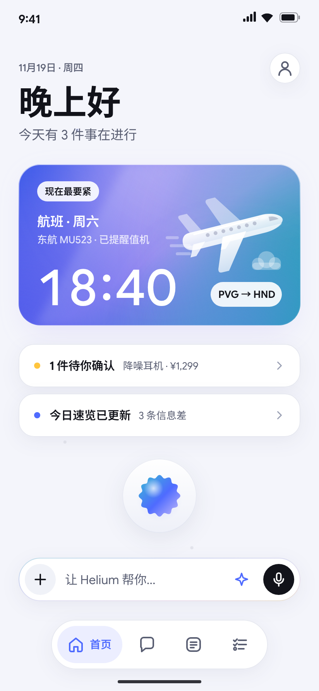
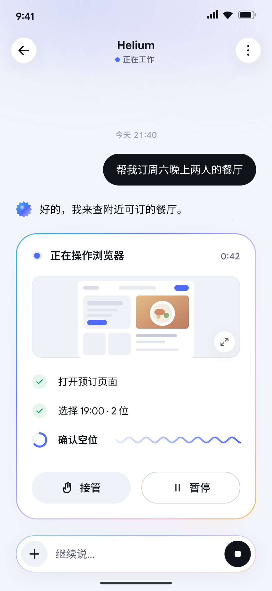
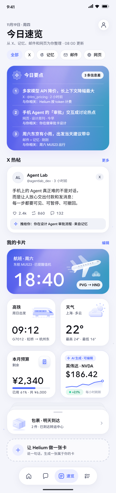
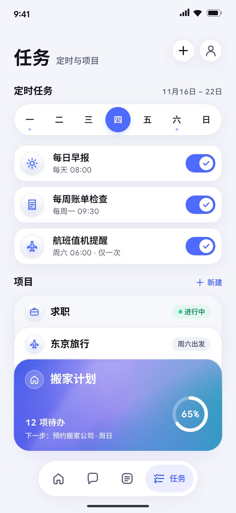
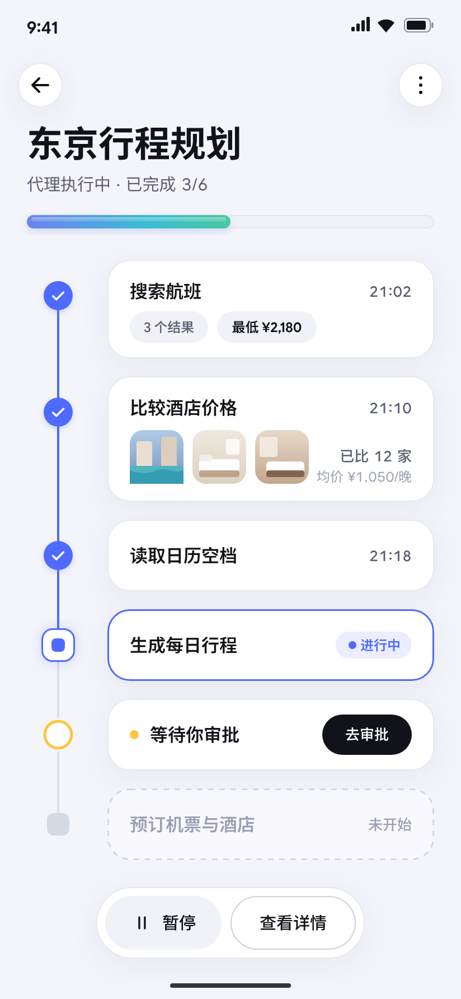
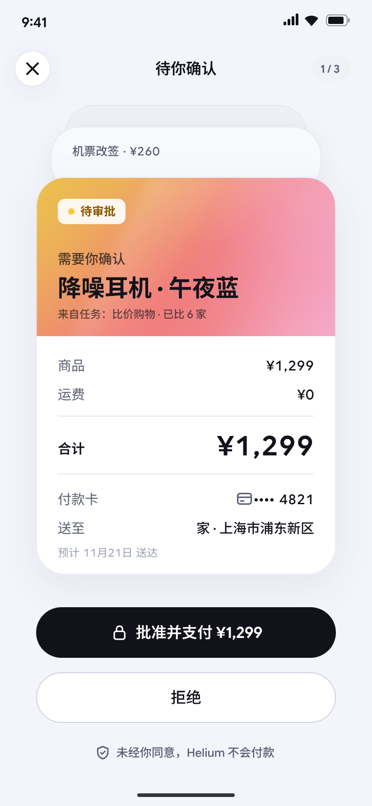
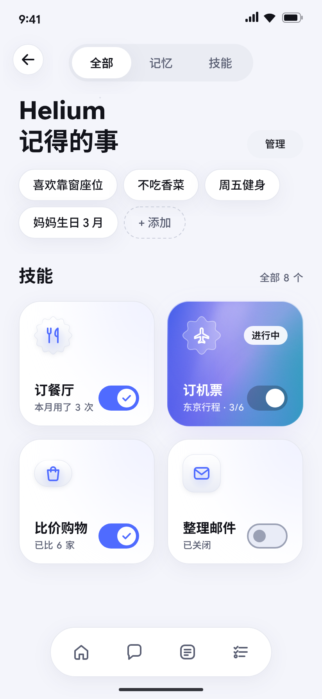
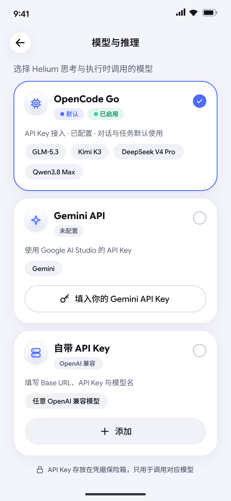

# Helium · 个人 AI Agent（Android MVP）

Helium 是装在手机里的个人 agent：记得你、能替你动手、在花钱 / 发送 / 删除前一定先问你。
这个仓库是 **v0.1.0 Android MVP**：按设计稿 v0.3 实现全部主要页面，**对话是真实的流式聊天**，其余页面先用本地示例数据（界面上标「示例」），数据接口已经分好层，后续接 Helium Cloud。

- 包名 `tech.qigai.helium` · minSdk 26 · targetSdk 35 · versionName 0.1.0
- Kotlin + Jetpack Compose + Material 3（自定义 Helium 主题 token）
- 许可证：MIT（字体为 SIL OFL 1.1，见 `third_party/fonts/`）

## 截图（设计稿）

| 首页 | 对话 | 速览 | 任务 |
|---|---|---|---|
|  |  |  |  |

| 任务时间线 | 审批 | 记忆与技能 | 模型与推理 |
|---|---|---|---|
|  |  |  |  |

更多：`design/png/00-components@2x.png`（组件表）、`08-glance-custom`（自定义卡 sheet）、`09-me`（我的）。设计说明见 `design/README.md`、`docs/DESIGN.md`。

## 功能

| 页面 | 内容 | 数据 |
|---|---|---|
| 首页 | 日期 + 问候、「现在最要紧」英雄卡（事件插画）、2 条提示（待你确认 / 今日速览）、Agent 光球、输入胶囊 | 示例；输入胶囊直接发起真实对话 |
| 对话 | 流式回复（Markdown、思考过程折叠）、停止 ↔ 发送同位且不丢草稿、出错可重试、顶部切换模型；顶部 live 任务卡（示例）可进入任务时间线 | **真实** |
| 速览 | 今日要点（来源筛选：全部 / X / 记忆 / 邮件 / 网页）、X 热帖、我的卡片 bento（航班 / 高铁 / 天气 / 预算 / AI 自定义股价卡 / 包裹叠卡）、「让 Helium 做一张卡」sheet（输入 → 预览 → 尺寸 → 刷新频率 → 添加） | 示例 |
| 任务 | 周历、定时任务（可开关）、项目叠卡（进度环），点项目进入时间线 | 示例 |
| 我的 | 头像入口；账户 / 能力 / 记忆与文件 / 安全 / 通用分组；关于页内含字体许可证 | 示例 + 真实模型设置 |
| 模型与推理 | OpenCode Go（默认）/ Gemini API / 自带 OpenAI 兼容 Base URL + Key；模型下拉、刷新模型列表、手填模型 ID | **真实** |
| 记忆与技能 | 记忆胶囊（添加 / 长按遗忘）、技能卡开关 | 示例（仅本次运行） |
| 审批 | 「待你确认」叠卡，批准 / 拒绝（只在本地，不会真的付款或发送） | 示例 |
| 任务时间线 | 进度条、完成 / 进行中 / 等你审批 / 未开始四种节点，「去审批」跳审批页 | 示例 |

底部导航：**首页 · 对话 · 速览 · 任务**；「我的」在各根页右上角头像。对话页按设计为全屏（无底栏）。

### 模型接入

| 提供方 | 协议 | 地址 |
|---|---|---|
| OpenCode Go（默认） | OpenAI 兼容 Chat Completions，SSE 流式，`Authorization: Bearer <key>` | `https://opencode.ai/inference/go/openai/v1/chat/completions` |
| OpenCode Go · Qwen3.8 Max | 该模型只提供 Anthropic 兼容 Messages 接口 | `https://opencode.ai/inference/go/anthropic/v1/messages` |
| Gemini API | `streamGenerateContent?alt=sse`，`x-goog-api-key` | `https://generativelanguage.googleapis.com/v1beta` |
| 自带 API Key | OpenAI 兼容 Chat Completions | 你填的 Base URL + `/chat/completions` |

默认 OpenCode Go 模型（ID 于 2026-11-19 从 `https://opencode.ai/inference/go/v1/models` 核对）：

| 显示名 | 模型 ID | 协议 |
|---|---|---|
| GLM-5.3 | `glm-5.3` | chat-completions |
| Kimi K3 | `kimi-k3` | chat-completions |
| DeepSeek V4 Pro | `deepseek-v4-pro` | chat-completions |
| Qwen3.8 Max | `qwen3.8-max` | messages |

「刷新模型列表」会重新拉取公开模型列表（只保留 chat-completions / messages 两种协议的模型）；也可以手填模型 ID。
OpenCode Go 要求每个会话带稳定的 `x-opencode-session` 头，并希望客户端用自己的 User-Agent：Helium 每个对话生成一个 UUID，并以 `Helium/0.1.0 (Android; tech.qigai.helium)` 标识自己。

API Key 只保存在本机「凭据保险箱」：AES-256-GCM 加密，密钥在 Android Keystore 中，SharedPreferences 里只有密文；界面上永远不回显。

## 配置 OpenCode Go Key

1. 在 opencode.ai 控制台开通 Go 订阅并创建 API Key。
2. 打开 App → 右上角头像「我的」→「模型与推理」→ OpenCode Go 卡片 →「填入 OpenCode Go API Key」，粘贴后保存。
3. 在同一卡片里点选模型（默认 GLM-5.3），或在对话页标题下的模型名处切换。
4. 回到首页，在输入胶囊里说一句话即可开始流式对话。

> 注意：OpenCode Go 官方说明它面向编码类 agent 的流量并会做滥用监控；把它用于通用个人助理对话前，请自行确认符合其使用条款。Gemini API 或自带 OpenAI 兼容服务可作为替代。

Gemini：同一页面「填入你的 Gemini API Key」（Google AI Studio 创建），模型默认 `gemini-flash-latest`，可选或手填。
自带 Key：填 Base URL（到 `/v1` 为止）、API Key、模型名。

## 构建

### GitHub Actions（推荐）

`.github/workflows/android.yml`：

- push 到 `main`、PR、手动触发：JDK 17 + Gradle 跑单元测试和 `assembleRelease`，上传 `helium.apk` 为 artifact。
- 推送 `v*` tag（例如 `git tag v0.1.0 && git push origin v0.1.0`）：额外创建 GitHub Release 并附 `helium.apk`。

签名：默认使用仓库里的**公开**签名 `keystore/helium-public.jks`（密码 `helium-public`，alias `helium`），保证每次 CI 产物签名一致、可直接覆盖安装。它是公开的，不适合正式上架；要用私有 key，在仓库 Secrets 里设置：

| Secret | 内容 |
|---|---|
| `HELIUM_KEYSTORE_BASE64` | `base64 -w0 release.jks` |
| `HELIUM_KEYSTORE_PASSWORD` | keystore 密码 |
| `HELIUM_KEY_ALIAS` | key alias |
| `HELIUM_KEY_PASSWORD` | key 密码 |

### 本地

```bash
# 需要 JDK 17 和 Android SDK（platforms;android-35），local.properties 里写 sdk.dir=...
./gradlew testReleaseUnitTest assembleRelease
# 产物：app/build/outputs/apk/release/app-release.apk
```

关键版本：AGP 8.7.3 · Gradle 8.9 · Kotlin 2.0.21（Compose compiler plugin）· Compose BOM 2024.12.01 · navigation-compose 2.8.5 · lifecycle 2.8.7 · activity-compose 1.9.3 · OkHttp 4.12.0。

## 代码结构

```
app/src/main/java/tech/qigai/helium/
├─ MainActivity.kt / HeliumApplication.kt
├─ data/
│  ├─ llm/        Models.kt（提供方、协议、模型目录）· LlmClient.kt（三种协议的 SSE 流式客户端）
│  ├─ settings/   SecureStore.kt（Keystore 凭据保险箱）· SettingsRepository.kt
│  └─ sample/     Domain.kt（领域模型 + *Source 接口）· SampleData.kt（示例数据 + Sources 定位器）
└─ ui/
   ├─ theme/      Tokens.kt（色值 / 8dp 间距 / 圆角 20·28·32 / 按钮 56·48·36）· Type.kt · Theme.kt · HeGradients.kt（生成）
   ├─ icons/      HeIcons.kt（生成：54 个 24dp 线性图标）
   ├─ illo/       HeIllustrations.kt（生成：11 种事件插画 × hero/light）
   ├─ components/ 卡面、英雄渐变、玻璃图标、按钮、标签、开关、光球、输入胶囊、底部导航、Markdown
   ├─ screens/    首页、对话（+ ChatViewModel）、速览、任务、我的、模型与推理、记忆与技能、审批、任务时间线
   └─ nav/        HeliumNavHost.kt
```

接后端时，实现 `data/sample/Domain.kt` 里的 `HomeSource` / `GlanceSource` / `TaskSource` / `MemorySource` / `ApprovalSource` / `RunSource`，在 `Sources` 里替换即可，页面不用改。

`HeIcons.kt`、`HeIllustrations.kt`、`HeGradients.kt` 由 `tools/gen_kotlin.py` 从 `design/src/hel.py` 生成（需要 Python 3、Pillow、svgelements 和设计字体）：

```bash
python3 tools/gen_kotlin.py design/src app/src/main/java/tech/qigai/helium/ui
```

## 目录

- `design/` 设计稿 v0.3（SVG、2x PNG、README、生成脚本 `src/`）
- `docs/` 产品方案 `PLAN.md`、设计说明 `DESIGN.md`、借鉴仓库 `repos.md`
- `third_party/fonts/` 字体许可证
- `keystore/` 公开 CI 签名

## 已知限制（v0.1）

- 除对话与模型设置外都是示例数据；记忆 / 自定义卡的增删只保存在本次运行。
- 对话历史只在内存中，退出 App 即清空；暂不支持附件、语音、工具调用。
- 只有浅色主题；未开启动态取色（保持单一强调色）。
- Release 未开启 R8 混淆 / 压缩，APK 约 20+ MB（主要是完整的 Noto Sans SC 可变字体）。
